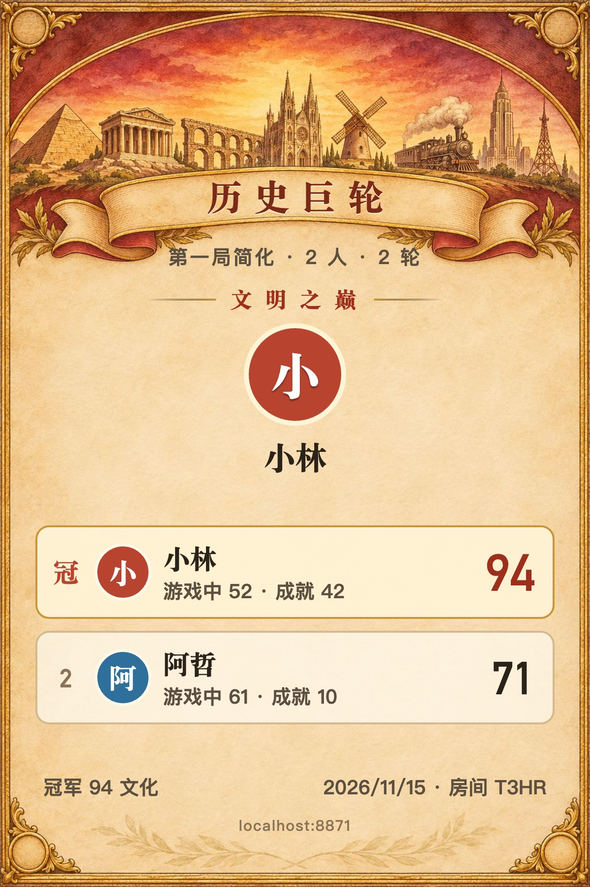
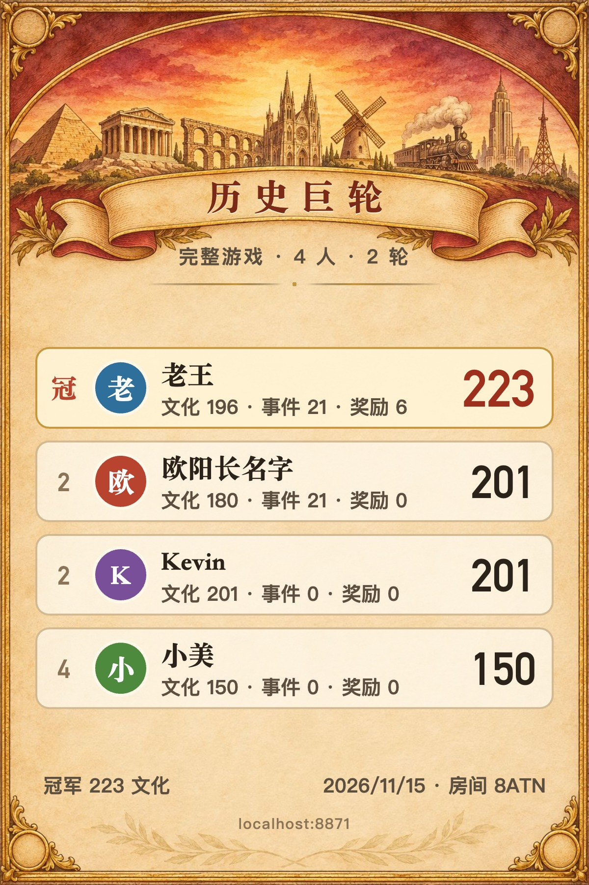

<div align="center">

# 历史巨轮小助手

**开局不漏 · 时代不乱 · 计分不错**

《历史巨轮：人类文明新篇章》（Through the Ages: A New Story of Civilization，CGE 2015，简中版一刻馆）线下对局的多人同步工具：开局清单、时代转换提醒、最后一轮判定、回合速查、终局计分，支持官方第一局简化玩法、短局和和平局变体，以及扩展《新领袖&新奇迹》的开局。

一桌人用手机扫码进同一个房间，所有操作实时同步，无需下载、无需注册。地址：https://tta.leisurecat.cloud

</div>

---

## 做什么、不做什么

开发前做了社区调研（BGG 规则区 581 个主题全部抓取、B 站讲规视频和评论、CGE 官方简中规则书和玩家手册），原则是：线下用实物更方便的留在线下，繁琐、易错、需要记录的才放到线上。清单和依据见 [docs/调研清单.md](docs/调研清单.md)（用户 2026-11-13 确认，全部按推荐），完整报告在 [docs/调研/](docs/调研/)，规则笔记（逐条注页码）在 [docs/规则笔记.md](docs/规则笔记.md)。

- **做**：按人数、玩法和扩展生成的开局清单；全桌共用的对局进度（时代、轮数、起始玩家、退出的人）；时代转换时全桌弹出清理清单、每人点“做完了”；最后一个时代开始时判定本轮还是下一轮是最后一轮；回合速查；「别忘了」易错规则；终局计分（第一局按玩家手册 7 项自动加总，完整游戏逐张登记时代 III 事件）；讲规则页；常见问题；规则助手。
- **不做**：电子玩家版图（资源、工人、蓝黄标记、行动点）、文化 / 科学 / 军力轨、回合末结算计算器、卡牌列和军事牌的逐张记录、殖民竞拍、扩展混合模式的随机抽牌、单卡图鉴、中途存档、棋钟、老版规则、单人机器人。玩家版图本身就是记录器，官方 App 已经是数字版。

## 功能一览

### 6 分钟讲规则（/teach）

首页「第一次玩？6 分钟讲规则」。讲的人照着念主流程（7 段，每段标了大约几秒），每个重要要素用一句话点到，带下划线的词点一下弹出官方规则书里的图和注释，每段末尾的「问」一点就问规则助手。主流程讲完，再一条条过「注意事项」（第一局 16 条，完整游戏 18 条），每条都写好答案，默认收起。顶部切换「第一局简化 / 完整游戏」，每台手机记住自己的选择。页面底部是按桌上位置分组的图标速查（33 个）。

图片截自 CGE 官方简体中文版规则书和玩家手册，页脚署名并链接原文。讲稿和注意事项用自己的话写，数据都在 `public/teach.js` 开头。

### 准备

玩法四选一：第一局简化（玩家手册，默认）、完整游戏、短局变体、和平局变体（可加全球冲突）。非第一局可选扩展三部分：平衡修订、新军事牌、新领袖新奇迹（纯扩展 / 秘密混合 / 公开混合）。2–4 人，座位按顺时针排，起始玩家可以跳到「桌游小助手」首页用手指轮盘或抽签定；每个座位显示第一轮几个内政行动点。

「看开局清单」按人数、玩法和扩展列出：每个时代删几张牌（含平衡修订后的新张数）、2 人局删条约、第一局和变体要拿掉的牌、扩展的替换和混合步骤、事件牌堆张数、玩家区摆放、第一轮行动点。每条标页码，点一条勾一条。

### 进度

顶部显示当前时代、第几轮、每回合开头移除卡牌列前几格（按剩余人数）。

- 第一轮卡片：第一轮和别的轮不一样的地方。
- 起始玩家开新一轮时点「开始第 N 轮」；第 2 轮开始时时代 A 自动结束，所有手机弹出换牌堆的步骤。
- 当前内政牌堆发完时点「内政牌发完了」，所有手机弹出时代转换清单（弃过时的牌、移除过时的领袖和未完成奇迹、每人失去 2 个黄色标记、换牌堆；有人退出过要重新删牌；短局看时代 III 事件；全球冲突加分），每人做完点自己的名字。
- 最后一个时代开始时问“是不是起始玩家的回合”，横幅提示本轮或下一轮是最后一轮、由谁打完；最后一轮打完点「去计分」。
- 「回合速查」按人数和玩法显示回合开始、政治阶段、行动阶段、回合结束五步和事件牌堆；「别忘了」；「有人体面退出」；撤销。

### 计分

每人在自己手机上填，「全桌总览」可以代填。

- 第一局：文化点数，加时代 I / II 科技牌、政府再算一次、科学增速、军力、幸福、食物和资源产量、殖民地 ×3、时代 II 奇迹 ×6（玩家手册第 21 页）。
- 完整游戏 / 和平局：全桌共用一个“终局事件”列表（当前和未来事件牌堆里剩下的时代 III 事件，可以写卡名），每人按卡面填每张得几分；再加终局奖励。短局另加时代 II 奇迹 ×6。
- 「结算」页显示排名、得分构成和成就，文化平手共享胜利，可以保存结算长图，并给游戏打分（写到总入口的评价里，game key `through-the-ages`）。

### 打印海报（3 寸相纸）

结算页「打印」生成一张 1200×1800 的竖版海报（2×3 英寸，600 dpi），给口袋照片打印机用：上方是时代变迁的插画和“历史巨轮”缎带标题，2–3 人时有“文明之巅”冠军徽章，下面按名次列出每位玩家的头像、名字、总分和分项（每行同样几项，按全桌有没有得分决定，最多 3 项：第一局是游戏中文化、成就；完整游戏是文化、事件，有人得了才加奇迹、奖励），底部是日期、房间号和站点地址。字号和留边按总目录 `docs/打印海报说明.md`：正文不小于 40 px、名字不小于 52 px、总分不小于 90 px，重要内容离四边至少 60 px。

底图 `public/img/poster-bg.jpg` 是用 Codex 生成的原创插画（金色边框、金字塔到摩天楼的时代剪影、空白缎带，没有文字），点「打印」时才加载。海报在隐藏的 600×900 节点里排版，用 html2canvas 按 2 倍截图，生成后在图片查看层里长按保存，再用打印机 App 选 3 寸相纸打印。

 

## 技术

Cloudflare Workers + 静态资源，原生 JS，无构建步骤。每个房间一个 Durable Object（`Room`），`Lobby` 记首页房间列表，`Archive` 存往期对局。`public/logic.js` 是前后端共用的规则逻辑，服务端 `reduce()` 权威校验；`public/steps.js` 是开局清单、时代转换和回合速查的文字。规则助手 `/api/chat` 依据 `tools/讲解稿.md` 和 `tools/faq.json`，资料没有时联网查找（先 BGG），模型顺序和超时同系列其他站。常见问题页 `public/guide.html` 由 `python3 tools/build_guide.py tools/faq.json public/guide.html` 生成。

## 本地运行和测试

```bash
wrangler dev --port 8871
```

测试用 Playwright（`playwright-core` + 本机 Chrome），对着本地 `wrangler dev` 运行：

```bash
node tests/test_logic.mjs                                               # 规则单元测试（不需要服务器）
node tests/test_room.mjs    http://localhost:8871/ ./shots               # 双手机 3 人第一局：每次时代转换、撤销、最后一轮、计分、结算、长图
node tests/test_history.mjs http://localhost:8871/ ./shots --many-rooms  # 往期对局存档、搜索、成绩参照；房间多时首页按钮仍在首屏
node tests/test_review.mjs  http://localhost:8871/ ./shots               # 结算页评价卡（总入口接口用 page.route 拦截，不写线上数据）
node tests/test_poster.mjs  http://localhost:8871/ ./shots               # 打印海报：2 / 3 / 4 人各一张，1200×1800、名次和总分、字号、留边、不重叠
node tests/test_teach.mjs   http://localhost:8871/ ./shots               # 讲规则页：段落、要素、术语弹窗、两种模式、注意事项、图标速查、手机宽度
node tests/test_chat.mjs    http://localhost:8871/ ./shots --no-key      # 规则助手界面（wrangler dev 不带密钥）
node tests/test_chat.mjs    http://localhost:8871/ ./shots --fake-key    # 请求校验、上游出错、限流
node tests/test_chat.mjs    http://localhost:8871/ ./shots --mock-upstream   # 备用模型切换
node tests/test_chat.mjs    http://localhost:8871/ ./shots --mock-web    # 联网查找
node tests/test_teach.mjs   https://tta.leisurecat.cloud/ ./shots         # 讲规则页也可以对线上跑
node tests/test_history.mjs https://tta.leisurecat.cloud/ ./shots --live  # 线上冒烟：打完一局再撤销，不留记录
```

`--fake-key`、`--mock-upstream`、`--mock-web` 需要 `wrangler dev --port 8871 --var DEEPSEEK_API_KEY:fake --var DEEPSEEK_BASE:http://127.0.0.1:8842 --var CHAT_CF_MODEL:@cf/none/missing`，每组之间隔一分钟（每分钟 8 问的限流）。打完整局的测试会在往期对局里留下记录，所以请对本地 `wrangler dev` 运行；线上只跑 `--live`。

## 部署

```bash
wrangler deploy
wrangler secret put DEEPSEEK_API_KEY --name through-the-ages-helper   # 规则助手的密钥，由用户自己设置
```

Worker `through-the-ages-helper`，自定义域名 `tta.leisurecat.cloud`，rate limit namespace 1171。CHAT_STATE 只读绑定匹兹堡站的 KV（DeepSeek 不通时先用 Qwen），本站不设 cron。

## 版权

非官方玩家工具。《历史巨轮》规则、卡图和封面版权归 Czech Games Edition 和一刻馆所有。讲规则页的图片截自 CGE 官方简体中文版规则书和玩家手册并署名；规则说明和常见问题都是自己的话。
